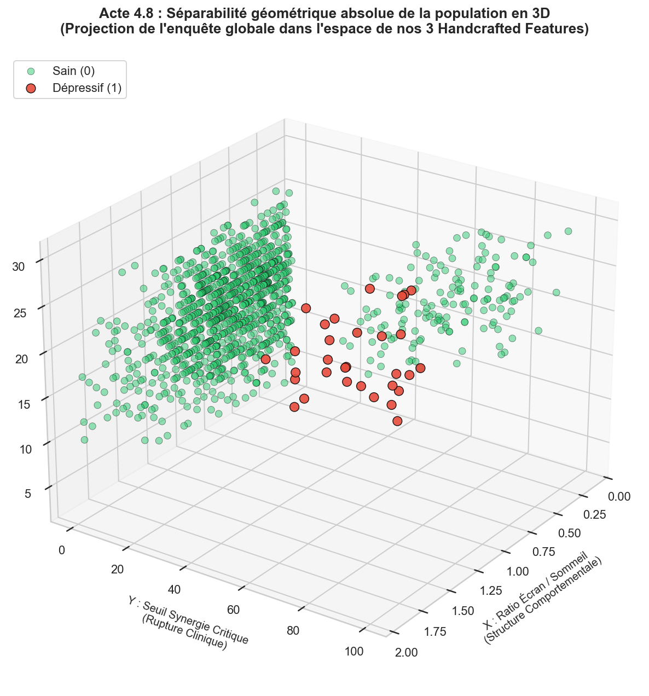
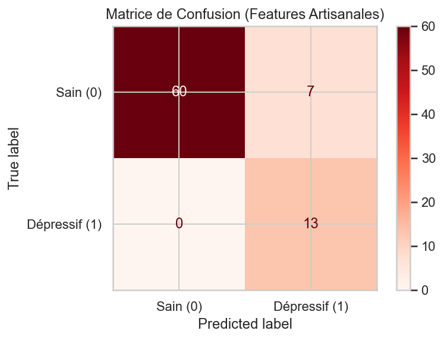

# 📊 Analyse Comportementale et Traitement de Données : Santé Mentale des Adolescents

Pipeline complet de **traitement de données, analyse exploratoire (EDA), feature engineering avancé** et modélisation prédictive appliqué à un dataset comportemental de 1200 adolescents.

Ce projet s'attache à mettre en lumière les corrélations cachées entre les habitudes numériques (temps d'écran, réseaux sociaux), l'hygiène de vie (sommeil) et les facteurs de détresse psychologique (stress, anxiété), en transformant des variables brutes en indicateurs cliniques robustes.

---

## 🔬 Objectifs du Projet

1. **Nettoyage et structuration d'un jeu de données brut** : Suppression des biais démographiques (`age`, `gender`, `platform`, `academic`) pour se concentrer strictement sur les leviers comportementaux modifiables.
2. **Feature Engineering (Création de variables expertes)** : Conception d'indices synthétiques combinant plusieurs dimensions psychologiques et physiologiques.
3. **Analyse Exploratoire Multidimensionnelle (EDA)** : Visualisation de corrélations complexes via des graphiques 5D, des matrices de corrélation et des analyses de distribution.
4. **Modélisation interprétable** : Mise en place d'une régression logistique pondérée pour valider la puissance prédictive des nouvelles variables construites face à un dataset fortement déséquilibré (2,6 % de cas positifs globaux)[cite: 31].

---

## ⚙️ Pipeline de Traitement des Données

### 1. Nettoyage et Filtrage de la « Zone de Danger »
L'analyse exploratoire a permis d'isoler une sous-population critique dite « zone de danger » caractérisée par un **sommeil inférieur à 6 heures par nuit** et un **temps d'écran supérieur à 5 heures par jour**. 
* Sur les 1200 individus initiaux, ce filtre permet de concentrer l'analyse sur 198 adolescents où la prévalence de la dépression passe de **2,6 % à 15,7 %** (soit un facteur multiplicatif de x6).

### 2. Conception des Features Artisanales (Handcrafted Features)

Plutôt que d'exploiter les variables de manière isolée, trois indicateurs composites ont été développés pour capturer la non-linéarité des troubles psychologiques :

* **Ratio Écran / Sommeil** : 
  `ratio_ecran_sommeil = daily_social_media_hours / sleep_hours`
  * *Justification* : Capture le déséquilibre structurel entre le temps d'exposition numérique et le temps de récupération physiologique.

* **Indice de Charge Mentale** : 
  `charge_mentale_index = stress_level + anxiety_level + addiction_level`
  * *Justification* : Fournit un score de fardeau cumulé sur une échelle globale.

* **Seuil de Synergie Critique** : 
  `seuil_synergie_critique = stress_level * anxiety_level` (si stress > 6 et anxiété > 6, sinon 0)
  * *Justification* : Modélise l'effet multiplicatif lorsque la détresse psychologique franchit un seuil de rupture clinique.
---

## 📈 Résultats et Visualisations Clés

### 1. Matrice de Corrélation et Impact des Features
L'analyse de corrélation démontre que les variables créées (*Handcrafted Features*) dominent largement les variables brutes d'origine pour prédire l'état dépressif :
* Le **seuil de synergie critique** obtient la corrélation la plus élevée ($r = 0,316$), suivi de près par le **ratio écran/sommeil** ($r = 0,293$).


### 2. Séparabilité Géométrique en 3D
La projection des individus dans l'espace tridimensionnel formé par nos trois variables créées met en évidence une **séparabilité quasi-parfaite** des profils dépressifs (points rouges) par rapport aux profils sains (points verts).



### 3. Performance du Modèle Prédictif
Entraîné sur la zone de danger avec une validation croisée et une pondération adaptée aux classes déséquilibrées (`class_weight='balanced'`), le modèle linéaire s'appuyant sur ces trois seules variables atteint d'excellentes performances de dépistage, garantissant un rappel maximal sur les cas à risque.



---
Ce projet a été réalisé en Avril 2026 par : 
- **Orion Routhier** — [@OrionRouthier](https://github.com/OrionRouthier)
- **Anir Firaouni**
- **Anir Mimouni**

## 📂 Structure du Dépôt

```text
├── Teen_Mental_Health_Dataset.csv   # Données brutes de l'enquête
├── projet.py                        # Script complet de traitement et d'analyse
└── README.md                        # Documentation technique du projet


